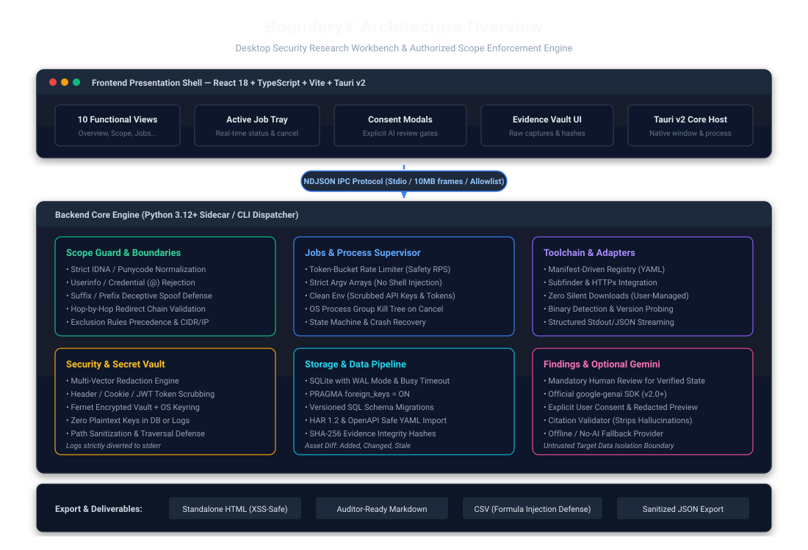
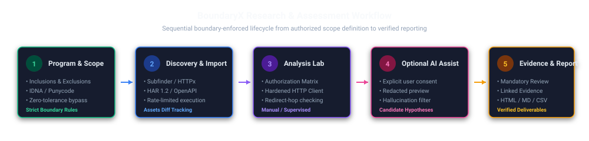

# BoundaryX

[](https://github.com/yut3ev/BoundaryX/actions/workflows/ci.yml)
[](https://github.com/yut3ev/BoundaryX/actions/workflows/release.yml)
[](LICENSE)
[](https://www.python.org/)
[](https://v2.tauri.app/)
[](https://www.typescriptlang.org/)

> **BoundaryX** is an open-source desktop security research workbench for authorized web application penetration testing, authorization flaw analysis, and bug bounty reconnaissance. It provides a boundary-enforced environment connecting scope management, asset discovery, deterministic test planning, and cryptographically verified evidence reporting.

An Arabic quick-start guide is available at [docs/QUICKSTART_AR.md](docs/QUICKSTART_AR.md).

---

## 1. Feature Overview

- **Strict Engine-Level Scope Enforcement:** Zero-tolerance boundary protection implemented in the core engine. Automatically rejects suffix/prefix spoofing, IDNA homograph collisions, embedded credentials, and out-of-scope HTTP 3xx redirect hops.
- **Unified Toolchain Orchestration:** Managed execution of community reconnaissance tools (Subfinder, HTTPx, dnsx, Katana, Nuclei, ffuf). Runs with strict argv arrays, scrubbed environments, rate limiters, and process-tree termination.
- **Traffic & Specification Importers:** Native ingestion of HTTP Archive (HAR 1.2), OpenAPI/Swagger 2.0/3.0 (safe YAML loader), CSV, and JSON traffic logs with automated credential scrubbing.
- **Evidence Integrity & Audit Vault:** SHA-256 cryptographic hashing on all stored evidence items. Findings require mandatory human review and linked evidence before reaching verified status.
- **Multi-Format Auditor-Ready Reporting:** Generates standalone HTML (with strict XSS escaping), Markdown, sanitized JSON, and CSV exports (with spreadsheet formula injection defense).
- **Optional Gemini Analyst (BYOK):** Optional assisted analysis using Google's official `google-genai` SDK. Operates fully offline in **No-AI mode**. When enabled, requires explicit user consent and redacted previews for every prompt, enforces XML boundary isolation, and validates citations against stored evidence IDs to filter hallucinated IDs.

---

## 2. Product Architecture



### Architectural Flow



1. **Desktop Shell (`apps/desktop`):** Tauri v2 host window rendering a React 18 + TypeScript frontend styled with dark-first security UI across 10 specialized views: Overview, Programs, Assets, Jobs, Traffic, Test Planner, Findings, Reports, Toolchain, and Settings.
2. **IPC Protocol Bridge:** High-performance newline-delimited JSON (NDJSON) over standard I/O (stdin/stdout) with a 10MB frame ceiling, structured event streaming, and an allowlisted command dispatcher. Operational logs are strictly routed to stderr.
3. **Core Engine (`engine`):** Python 3.12+ backend encapsulating SQLite storage (WAL mode, foreign keys enabled), process supervisor, job orchestrator, and security/redaction engines.
4. **Credential Vault:** Local encrypted store using OS Keyring integration with Fernet file vault fallback (`secrets.enc`). Keys and tokens are never written to SQLite, logs, or exports.

---

## 3. Platform Support & Maturity Status

- **Development Status:** Stable Initial Release ([v0.1.1](https://github.com/yut3ev/BoundaryX/releases/tag/v0.1.1)).
- **Verified Host Platforms:**
  - **Linux (Ubuntu 22.04 / 24.04 LTS x86_64):** Verified native `.deb` (42.50 MB) and standalone `.AppImage` (117.51 MB) installer packages built and verified in automated CI release pipeline.
    > [!NOTE]
    > **Distribution Compatibility:** Automated package generation confirms packaging integrity in clean pipeline environments. However, building packages does not guarantee identical installation across every Linux distribution; specific desktop environments may require runtime dependencies (such as `libwebkit2gtk-4.1-0`) or standard graphics stack packages.
  - **Windows 11 x86_64:** Sidecar engine packaging and local IPC execution verified.
- **Verified Test Suite:**
  - 43 Python Engine unit and integration tests (0 failures).
  - 169 Domain security, redaction, and scope tests (0 failures).
  - 1 Desktop IPC supervisor smoke test (`apps/desktop/src-tauri/tests/ipc_smoke_test.rs`) verifying live NDJSON forwarding, program creation, scope evaluation, and child-process cleanup (0 failures).
- **Official Release Artifacts ([v0.1.1](https://github.com/yut3ev/BoundaryX/releases/tag/v0.1.1)):**
  - `BoundaryX_0.1.0_amd64.deb` (`44,565,734 bytes`, SHA-256: `dc4d9f1fca2e2a4c9775abf10c0516bcdf47bb9a21dba814ee95ad63ab05f058`)
  - `BoundaryX_0.1.0_amd64.AppImage` (`123,218,424 bytes`, SHA-256: `4205bd82387cf8fb17ee76fecc19d3e08f5d1ac64e5852c20643956ccfc5843c`)
  - `SBOM.json` (CycloneDX 1.5, exact locked dependency versions, SHA-256 cryptographically verified)
  - `SHA256SUMS.txt` (package checksums)
- **Pending / Roadmap Platforms:**
  - macOS builds are structurally supported by Tauri v2 but pending formal Apple Silicon code signing.

---

## 4. Prerequisites

| Dependency | Minimum Version | Tested Version | Installation Link |
| :--- | :--- | :--- | :--- |
| **Python** | 3.12.0+ | 3.12.3 / 3.13.13 | [python.org](https://www.python.org/downloads/) |
| **uv** (Recommended) | 0.10.0+ | 0.13.1 | [docs.astral.sh/uv](https://docs.astral.sh/uv/) |
| **Node.js** | 20.0.0 LTS | 24.16.0 | [nodejs.org](https://nodejs.org/) |
| **npm** | 10.0.0+ | 11.13.0 | Included with Node.js |
| **Rust** (GUI build) | 1.75.0+ | 1.80.0+ | [rustup.rs](https://rustup.rs/) |

---

## 5. Quickstart & Fresh-Clone Setup

### Step 1: Clone the Repository
```bash
git clone https://github.com/yut3ev/BoundaryX.git
cd BoundaryX
```

### Step 2: Set Up the Python Engine
```bash
cd engine

# Create and activate virtual environment
python3 -m venv .venv
source .venv/bin/activate  # On Windows: .venv\Scripts\activate

# Install dependencies in editable mode
pip install -e ".[dev]"

# Run verified engine test suite
pytest tests/ -v
```

### Step 3: Set Up and Build the Desktop Frontend
```bash
cd ../apps/desktop

# Install frontend dependencies using committed lockfile
npm install

# Run TypeScript typechecks and production build
npm run build

# Start local Vite development server
npm run dev
```

### Step 4: Run the Engine in IPC Mode (Manual Smoke Test)
```bash
cd ../../engine
python -m boundaryx.cli --ipc
```

---

## 6. Linux Packaging & Installation

### Installing from Published Release
Download the verified `.deb` package from the [v0.1.1 Release](https://github.com/yut3ev/BoundaryX/releases/tag/v0.1.1):

```bash
# 1. Verify SHA-256 checksum before installation
sha256sum BoundaryX_0.1.0_amd64.deb
# Expected: dc4d9f1fca2e2a4c9775abf10c0516bcdf47bb9a21dba814ee95ad63ab05f058

# 2. Install package and required runtime dependencies
sudo apt-get update
sudo apt install -y ./BoundaryX_0.1.0_amd64.deb

# 3. Launch BoundaryX
boundaryx-desktop
```

### Local Packaging Recipes
The repository provides automated recipes for standalone binary packaging:

```bash
# Package Python engine into standalone sidecar binary
python scripts/build_engine.py

# Build Linux .deb and AppImage distribution packages (on Ubuntu with WebKitGTK)
bash scripts/package_linux.sh
```

*Note:* Compiling the desktop binary from source requires:
```bash
sudo apt-get update && sudo apt-get install -y libwebkit2gtk-4.1-dev build-essential curl wget file libssl-dev libgtk-3-dev libayatana-appindicator3-dev librsvg2-dev
```

---

## 7. External Toolchain Integration

BoundaryX interacts with external security utilities via manifest declarations in `config/tool-manifest.yaml`.

- **No Silent Downloads:** BoundaryX will never silently fetch or execute third-party binaries. Users maintain complete custody over their security tools.
- **Upstream Installations:**
  - **Subfinder:** `go install -v github.com/projectdiscovery/subfinder/v2/cmd/subfinder@latest`
  - **HTTPx:** `go install -v github.com/projectdiscovery/httpx/cmd/httpx@latest`
  - **dnsx:** `go install -v github.com/projectdiscovery/dnsx/cmd/dnsx@latest`
  - **Katana:** `go install -v github.com/projectdiscovery/katana/cmd/katana@latest`
  - **Nuclei:** `go install -v github.com/projectdiscovery/nuclei/v3/cmd/nuclei@latest`
  - **ffuf:** `go install github.com/ffuf/ffuf/v2@latest`
- **Graceful Tool Absences:** When an external tool is not installed, BoundaryX flags its status as uninstalled in the Toolchain view, provides the official installation command, and disables jobs requiring that tool without crashing.

---

## 8. Optional Gemini Analyst Setup

BoundaryX includes an optional AI-assisted hypothesis generation module powered by Google Gemini.

1. **Separation of Services:** Consumer Gemini web subscriptions (Gemini Advanced) are distinct from the Google Gemini Developer API. An API key from [Google AI Studio](https://aistudio.google.com/) is required.
2. **Secure Configuration:** Enter your API key in the Desktop application under **Settings → Gemini Analyst**. The key is stored in the local encrypted OS Keyring / Fernet vault. It is never persisted in SQLite or plain `.env` files.
3. **No-AI Mode:** If no key is configured or offline mode is selected, BoundaryX operates deterministically using local policy evaluation with zero external network calls.

---

## 9. Data Handling & Privacy Model

- **Local Storage:** All assessment artifacts, scope rules, and findings are stored locally in an encrypted SQLite database at `~/.boundaryx/boundaryx.db` (or platform equivalent).
- **Outbound Network Traffic:**
  - Core engine operations, recon parsing, and reports run entirely locally.
  - Active reconnaissance jobs communicate only with authorized in-scope targets.
  - No telemetries or tracking beacons are transmitted.
- **AI Hand-off Safeguards:**
  - Context is dispatched to the Gemini API **only** after explicit user confirmation in a dedicated review modal.
  - `RedactionEngine` strips `Authorization` tokens, session cookies, passwords, and API keys before context leaves the host.
  - Returned hypotheses are validated against stored evidence IDs; unverified citations are automatically discarded.

---

## 10. Authorized-Use Notice & Scope Safety

> **IMPORTANT:** BoundaryX is designed exclusively for authorized penetration testing, bug bounty programs with documented scope, and academic security research.

- The built-in `ScopeGuard` actively blocks targets outside authorized program definitions.
- Users are solely responsible for ensuring they possess written authorization from system owners prior to initiating active scans or test evaluations.

---

## 11. Troubleshooting

- **Engine IPC Connection Timeout:** Ensure Python 3.12+ is installed and present in your system `PATH`. Run `python -m boundaryx.cli --version` to verify engine responsiveness.
- **SQLite Database Locked:** BoundaryX configures SQLite in WAL mode with a 5000ms busy timeout. Ensure the storage directory is on a local filesystem (not a network mount or cloud-synced folder).
- **Redirect Scope Errors (`ScopeDenialError`):** If an HTTP test fails with a scope denial on redirect, inspect whether the target endpoint issues a 302 redirect to an external identity provider (e.g. Google/GitHub OAuth). Add the specific redirect host to your scope exclusions or update your testing flow.
- **Frontend Build Issues:** Ensure Node.js 20+ is active. Delete `node_modules` and run `npm install` to restore packages from the committed `package-lock.json`.

---

## 12. Security Reporting & Contributing

- **Security Advisories:** Review our vulnerability disclosure policy in [SECURITY.md](SECURITY.md). Please report vulnerabilities responsibly to security@boundaryx.dev (or via GitHub Private Vulnerability Reporting).
- **Contributions:** Contributions are welcome. See [CONTRIBUTING.md](CONTRIBUTING.md) for style guides, branch naming, and pull request procedures.
- **License:** Licensed under the [MIT License](LICENSE).
