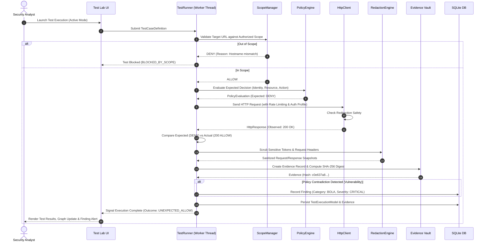

# BoundaryX System Architecture

BoundaryX is engineered from the ground up as a desktop application security testing and authorization analysis tool. It adheres strictly to **Clean Layered Architecture** principles, prioritizing modularity, type safety, deterministic evaluation, and defensive security.

---

## 1. High-Level Architectural Layers

The system is organized into five distinct layers. Dependencies flow strictly downward from Presentation to Infrastructure and Domain, with the Security layer providing cross-cutting invariants.

```mermaid
flowchart TD
    subgraph UI ["Presentation Layer (Qt / PySide6)"]
        MainWindow["MainWindow & Navigation"]
        Pages["Pages (Scope, Identities, Lab, Graph, Findings, Reports)"]
        Components["Components & Dialogs"]
    end

    subgraph AppLayer ["Application Layer"]
        ProjectService["ProjectService"]
        ScopeService["ScopeService"]
        TestCaseService["TestCaseService"]
        TestRunner["TestRunner & AsyncWorker"]
        AnalysisService["AnalysisService"]
        ReportService["ReportService"]
    end

    subgraph SecurityLayer ["Security Layer"]
        ScopeManager["ScopeManager (Strict Host & Redirect Guard)"]
        SecretManager["SecretManager (Fernet Encryption)"]
        RedactionEngine["RedactionEngine (Credential Scrubbing)"]
        AuditLogger["AuditLogger (Tamper-Evident Trail)"]
    end

    subgraph DomainLayer ["Domain Layer (Pure Business Logic)"]
        IdentitiesDomain["Identities & Auth Profiles"]
        TenantsDomain["Tenants & Memberships"]
        ResourcesDomain["Resources & Catalogs"]
        PolicyEngine["PolicyEngine (Deterministic Matrix & Invariants)"]
        GraphModel["Trust Graph & Relationships (NetworkX)"]
        EvidenceModel["Evidence Records & SHA-256 Proofs"]
        FindingsModel["Finding Lifecycle & Confidence Models"]
    end

    subgraph InfraLayer ["Infrastructure Layer"]
        DBManager["DatabaseManager & SQLAlchemy ORM"]
        Repositories["Specialized Model Repositories"]
        HTTPClient["HttpClient (HTTPX + Token-Bucket + Scope Guard)"]
        Importers["Importers (HAR 1.2, Raw HTTP, JSON)"]
        Exporters["Exporters (HTML, Markdown, JSON, CSV, Bundles)"]
        LoggingSystem["LoggingSystem & SecretFilter"]
    end

    UI --> AppLayer
    AppLayer --> DomainLayer
    AppLayer --> SecurityLayer
    AppLayer --> InfraLayer
    InfraLayer --> DomainLayer
    InfraLayer --> SecurityLayer
    SecurityLayer --> DomainLayer
```

---

## 2. Layer Responsibilities & Constraints

### 2.1 Domain Layer (`boundaryx.domain`)
- **Purity**: Zero knowledge of databases, network protocols, or UI widgets.
- **Pydantic Validation**: All domain entities are defined using Pydantic v2 models with strict type annotations.
- **Key Modules**:
  - `identities`: Subject definitions (`Identity`), role classifications (`RoleType`), authentication profiles (`AuthenticationProfile`).
  - `resources`: Protected assets (`Resource`), resource categories (`ResourceType`), sensitivity classifications (`SensitivityLevel`), and multi-tenant boundaries (`Tenant`, `TenantMembership`).
  - `policies`: Authorization policies (`Policy`), subject/resource selectors (`SubjectSelector`, `ResourceSelector`), actions (`PolicyAction`), and the deterministic `PolicyEngine`.
  - `relationships`: Directed graph edges (`Relationship`) linking entities with relationship categories (`OWNS`, `MEMBER_OF`, `HAS_ACCESS`, `VIOLATES`).
  - `evidence`: Cryptographically verifiable records (`Evidence`, `HttpSnapshot`) with SHA-256 content hashes.
  - `findings`: Detected vulnerabilities (`Finding`), categories (`FindingCategory`), severities (`FindingSeverity`), and structured confidence reasoning (`ConfidenceExplanation`).

### 2.2 Security Layer (`boundaryx.security`)
- **Cross-Cutting Invariant Enforcement**:
  - `ScopeManager`: Verifies all target URLs, schemes, ports, and paths against explicit inclusion and exclusion rules. Strictly enforces hostname normalization (Punycode/IDN) and evaluates each HTTP redirection independently.
  - `SecretManager`: Manages credentials, tokens, and encryption keys using authenticated symmetric encryption (`cryptography.fernet.Fernet`). Enforces secure file permissions (`0o600`).
  - `RedactionEngine`: Multi-vector regex and pattern scrubbing to ensure passwords, bearer tokens, API keys, and session cookies are sanitized prior to export or logging.
  - `AuditLogger`: Writes immutable, sanitized audit records for every security-relevant application state transition.

### 2.3 Infrastructure Layer (`boundaryx.infrastructure`)
- **Persistence**: SQLite database accessed via SQLAlchemy 2.x declarative models (`boundaryx.infrastructure.database.models`).
- **SQLite Pragmas**:
  - `PRAGMA foreign_keys = ON`: Strict foreign key constraint enforcement.
  - `PRAGMA journal_mode = WAL`: Write-Ahead Logging for high concurrency.
  - `PRAGMA synchronous = NORMAL`: Optimal I/O balance in WAL mode.
  - `PRAGMA busy_timeout = 10000`: 10-second lock mitigation.
- **Network Client (`HttpClient`)**:
  - Built on HTTPX with thread-safe token-bucket rate limiting.
  - Automatic scope checking prior to dispatching requests.
  - Disables automatic redirects (`follow_redirects=False`) to manually validate each redirection target.
- **Data Ingestion & Export**:
  - Ingestion: Safe parsing of HAR 1.2 archives, raw RFC 7230 text, and native JSON.
  - Exporters: Generation of 14-section audit reports in Markdown, self-contained HTML, JSON, and CSV.

### 2.4 Application Layer (`boundaryx.application`)
- **Service Orchestration**: Coordinates domain entities, repositories, and security guards.
- **Services**:
  - `ProjectService`: Project lifecycle, backup creation, and statistics calculation.
  - `ScopeService`: Manages scope rules in memory and coordinates database synchronization.
  - `TestCaseService`: Manages test case cataloging, parameter templates, and execution queuing.
  - `TestRunner`: Executes test suites across `OFFLINE`, `PREVIEW`, and `ACTIVE` modes.

### 2.5 Presentation Layer (`boundaryx.ui`)
- **PySide6 (Qt) Desktop UI**: Modern responsive interface with Dark and Light theme stylesheets.
- **Thread Safety**: Long-running testing operations run on background threads via `AsyncWorker` (`QThread`), communicating with the Qt event loop exclusively via Qt Signals and Slots.

---

## 3. Policy Evaluation & Testing Lifecycle

When an authorization test case is executed in BoundaryX, the following sequence of operations occurs:

---

## 4. Concurrency & Rate Limiting Model

BoundaryX uses a token-bucket rate limiter to prevent denial-of-service conditions or triggering target rate limits during active authorization testing:

- **Token Bucket Architecture**:
  - Configurable fill rate (e.g., 5.0 requests per second).
  - Maximum burst capacity equals the configured RPS limit.
  - Synchronous execution blocks using `time.sleep` until a token becomes available.
  - Asynchronous execution awaits `asyncio.sleep` non-blockingly.
- **Concurrency Bounding**:
  - Active worker concurrency is constrained by a `threading.Semaphore` bounded to `max_concurrency` (default: 3-5 concurrent threads).
  - Cancellation tokens (`is_cancelled`) are evaluated before acquiring tokens, before socket connection, and before reading response payloads.

---

## 5. Storage & Portability Architecture

BoundaryX supports two deployment modes without code modification:

1. **Installed Mode**:
   - Windows: `%APPDATA%\BoundaryX\`
   - Linux: `~/.boundaryx/` or `$XDG_DATA_HOME/boundaryx/`
   - Database, logs, backups, and encryption keys reside in dedicated user directories.

2. **Portable Mode** (`--portable`):
   - All runtime state is localized relative to the application executable directory.
   - Ideal for forensic jump-boxes, USB drives, or isolated assessment machines.
   - Self-contained SQLite database (`boundaryx.db`), logs (`logs/`), and exports (`exports/`).
